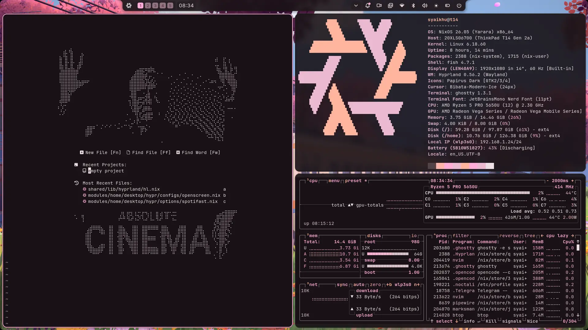
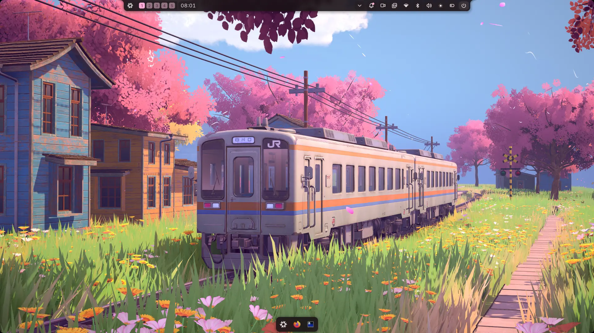
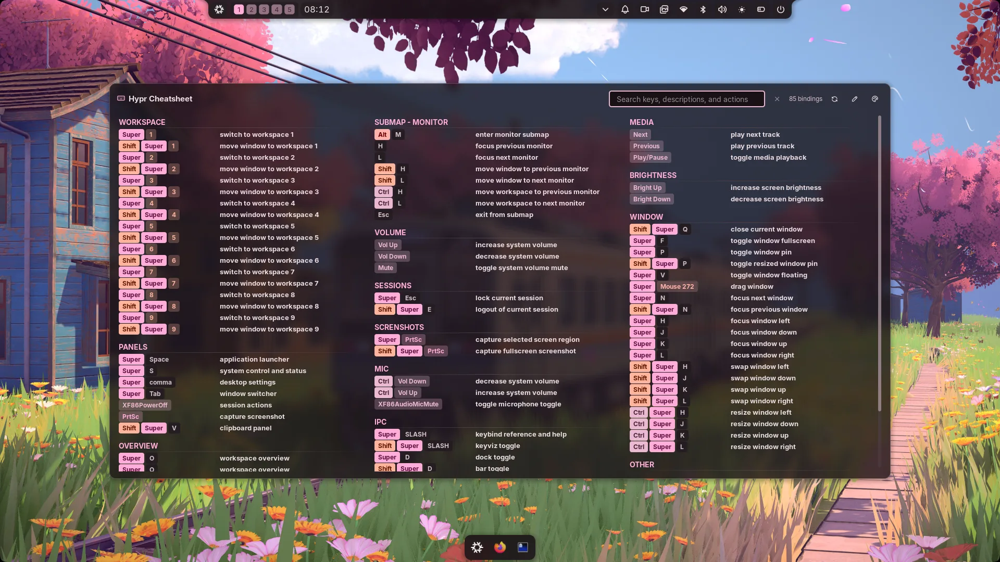
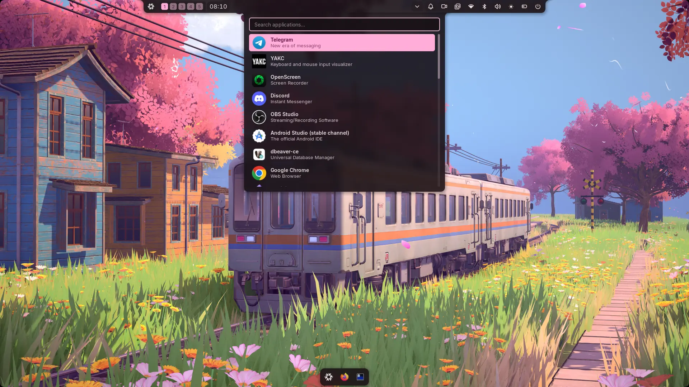

<div align="center">
    <h1>[nv] nullveilheim ❄️</h1>
    <br>
    <div align="center">
        <a href="https://github.com/sekhudin/nullveilheim/actions/workflows/ci.yaml">
            
        </a>
        <a href="https://github.com/sekhudin/nullveilheim">
            
        </a>
        <a href="https://nixos.org">
            
        </a>
        <a href="https://github.com/Sekhudin/nullveilheim/blob/main/LICENSE">
            
        </a>
    </div>
    <br>
</div>

Personal Nix configurations for Linux and macOS.

This repository contains my system and user environment built with
[Nix](https://nixos.org/), including [NixOS](https://nixos.org/),
[Home Manager](https://github.com/nix-community/home-manager), and
[nix-darwin](https://github.com/nix-darwin/nix-darwin).

The setup is actively evolving and is primarily designed for my own machines
and workflow.

> **Warning:** This repository contains personal NixOS, nix-darwin, and
> Home Manager configurations. The configurations may assume specific hardware,
> usernames, filesystem paths, desktop capabilities, and encrypted secrets.
> Review the relevant host configuration before applying it to another machine.
> Do not run `switch` commands blindly.

## What Do You Want to Do?

- [Install a new NixOS host](docs/hosts.md#installing-nixos-with-this-flake).
- [Add a host to the flake](docs/hosts.md#adding-a-nixos-host).
- [Configure Home Manager](docs/home-manager.md).
- [Configure Hyprland](docs/hyprland.md).
- [Develop and validate the repository](docs/development.md).

## Documentation

- [Architecture](docs/architecture.md) — repository layout and module flow.
- [Hosts](docs/hosts.md) — supported hosts, users, and apply commands.
- [Home Manager](docs/home-manager.md) — shell, terminal, theme, and activation options.
- [Hyprland](docs/hyprland.md) — desktop module structure and development workflow.
- [Development](docs/development.md) — validation, builds, and contribution workflow.

## Quick Start

### Requirements

- Nix with flakes enabled.
- Git.
- A supported NixOS, macOS, or Home Manager environment.
- Access to the required SOPS encryption keys when using secret-dependent
  activation modules.

Clone the repository and review the relevant configuration before applying it:

```sh
git clone https://github.com/sekhudin/nullveilheim.git
cd nullveilheim
nix flake show
nix flake check --all-systems
```

Apply a configuration only after reviewing its host and user files:

```sh
# NixOS
sudo nixos-rebuild switch --flake .#t14
sudo nixos-rebuild switch --flake .#acerswift

# nix-darwin
darwin-rebuild switch --flake .#mbp

# Standalone Home Manager
home-manager switch --flake .#syaikhu-sa
```

See [Hosts](docs/hosts.md) for the complete list, installation process, and
new-host workflow.

## Overview

The repository is organized around several layers:

- `configurations/` — host and user entrypoints.
- `modules/` — reusable NixOS, Home Manager, Darwin, and common modules.
- `parts/` — flake-parts modules, packages, overlays, development shells, and services.
- `shared/` — reusable helpers, colors, icons, and internal libraries.
- `secrets/` — encrypted SOPS data; secret values are intentionally not documented.
- `.opencode/` — repository-specific development instructions and skills.

For the complete architecture and dependency flow, see
[Architecture](docs/architecture.md).

## Desktop Environment

Linux desktop configurations use:

- **Hyprland** as the Wayland compositor and window manager.
- **Noctalia** as the desktop shell layer.
- Home Manager for user-level desktop configuration.
- Shared theme, color, icon, and variable helpers.

The desktop configuration includes wallpapers, bars, docks, launchers, audio
and brightness controls, notifications, screenshots, session controls,
Hyprland bindings and rules, and Noctalia integrations.

The desktop configuration is enabled for Linux and disabled for the macOS
desktop setup. See [Hyprland](docs/hyprland.md) for development details.

### Screenshots

<p align="center">
  
</p>

<table>
  <tr>
    <td align="center" width="33%">
      
      <br>
      <sub><b>Workspace</b></sub>
    </td>
    <td align="center" width="33%">
      
      <br>
      <sub><b>Cheatsheet</b></sub>
    </td>
    <td align="center" width="33%">
      
      <br>
      <sub><b>Application Launcher</b></sub>
    </td>
  </tr>
</table>

## Home Manager

Home Manager manages user-level configuration, including shells, terminals,
themes, packages, session variables, activation scripts, and user programs.

The main user configuration currently uses Fish, Ghostty, Nixvim, and the
Aurora theme. Shell, terminal, and activation settings are configurable; see
[Home Manager](docs/home-manager.md).

## Secrets

Secrets are encrypted with [SOPS](https://github.com/getsops/sops) and stored
in `secrets/secrets.yaml`. Never commit plaintext secret values.

The expected SOPS key names are documented in
[Home Manager → SOPS Key Structure](docs/home-manager.md#sops-key-structure);
secret values are intentionally omitted.

Secret-dependent activation can be disabled with:

```nix
homeCore.activation.enable = false;
```

The CI workflow does not decrypt or use repository secrets. See
[Home Manager](docs/home-manager.md) for activation behavior.

## Flake Outputs

The flake provides NixOS, nix-darwin, and Home Manager configurations, custom
packages, overlays, development shells, process-compose services, and checks.

Notable outputs include:

- `nixosConfigurations.acerswift`
- `nixosConfigurations.t14`
- `darwinConfigurations.mbp`
- `homeConfigurations.syaikhu@acerswift`
- `homeConfigurations.syaikhu@t14`
- `homeConfigurations.syaikhu@mbp`
- `homeConfigurations.syaikhu-sa`
- `packages.*.nixvim`
- `packages.*.pg-sandbox`
- `packages.*.mail-sandbox`
- `checks.*.nixvim`
- `checks.*.pre-commit`
- `devShells.*.default`
- `devShells.*.go`
- `devShells.*.nodejs24`
- `overlays.branches`
- `overlays.fish`
- `overlays.shellApplication`
- `overlays.tree-sitter`
- `overlays.vim`

Inspect the complete output set with:

```sh
nix flake show
```

## Useful Commands

```sh
nix flake check --all-systems
nix flake show
nix build .#nixvim
nix run .#pg-sandbox
nix run .#mail-sandbox
nix develop
nix develop .#go
nix develop .#nodejs24
```

For formatting, diff checks, and the contribution workflow, see
[Development](docs/development.md).

## Repository Structure

```text
.
├── .github/              # CI workflows
├── .opencode/            # repository-specific agents and skills
├── configurations/       # host and user entrypoints
├── docs/                 # detailed documentation and images
├── modules/              # reusable system and Home Manager modules
├── parts/                # flake outputs, overlays, packages, and shells
├── secrets/              # encrypted secrets
├── shared/               # reusable helper libraries
├── flake.nix
└── flake.lock
```

## Status

This is a personal configuration repository and is still under active
development. It is not intended to be a drop-in framework; some modules,
paths, secrets, hardware assumptions, and workflows are specific to my
machines and preferences.
